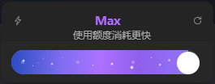
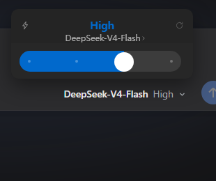
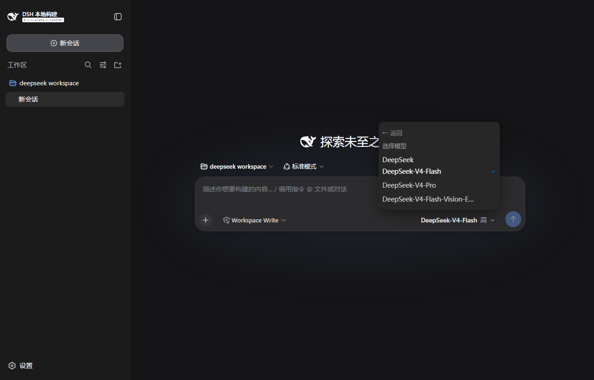
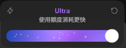

# Effort Dial · 推理强度拨盘

**接管 composer 里的模型选择器与思考档位**，换成 Codex 那张推理强度卡片：顶部是当前档位
（蓝色）、下面是当前模型行、再下面是带刻度点的滑杆。拖动或点击滑杆即切换当前会话的
`reasoningEffort`，右上角一键恢复模型默认值。

它不是一个并列的新按钮：注册在 `conversation.input.model` 上、以 priority -1 遮蔽出厂占用者，
所以 composer 右侧只有一个控件，模型切换和思考档位都在这一个框里完成。

The composer's model selector and reasoning-effort control, replaced by Codex's effort card.
Registered on `conversation.input.model` at priority -1 so it shadows the shipped occupant:
one control in the composer, model choice in the card's model row, effort on the slider, and
a reset to the model default in the top-right corner.

## 安装

```sh
dsh plugin --profile web add dsh-effort-dial
```

刷新页面即可使用（纯客户端插件，无需重启宿主）。

## 截图

最高档（Max / Ultra）的紫色特效与渐变星光：



普通档位（High）：



模型列表：



原版 Codex Ultra 对照：



## 使用

- **触发器**：composer 工具行右侧显示 `模型名 档位 ⌄`（模型名 14px 粗体、档位灰色，按 Codex
  的排版）。点击打开卡片。
- **档位**：数量、顺序与名字**完全来自当前模型的适配器目录**——DeepSeek 是 Off / Low / High / Max
  四档，直接显示适配器的英文名，滑杆最右端就是该模型的最高档。换模型后档位表跟随该模型。
- **拉满特效**：拖到最高档时，标题与触发器档位变成 Codex 的紫色 `#b06dff`，模型行换成警告文案
  「使用额度消耗更快」并隐藏箭头，滑杆从纯色淡入成蓝→紫渐变（`#2b4cc2 → #ac72ff → #9273f8`）
  并浮出 20 个闪烁白点；退回其余档位恢复蓝色 `#0169cc` 与模型名。
- **滑杆**：拖动时只更新视觉，松手提交；键盘 ← → 逐档切换，Home / End 跳到两端。
- **模型行**：点开是同一份模型目录的列表（标题「选择模型」+ 分组 + 勾选），选完回到滑杆。
- **右上角 ↻**：恢复该模型的默认档位。
- **Esc / 点击外部**：关闭面板。

## 行为

- 读写的状态与宿主自带的模型选择器**是同一份**：这里切换后，会话下一次请求就用新档位，
  刷新、重开都不丢（走 `session.selectModel`，落在会话历史投影里）。
- 当前模型没有推理档位时，触发器只显示模型名，面板说明原因。

## 动画（照搬原版 CSS module，位移与时长按观感加强）

- 卡片出现：`translateY(16px) scale(.97)` + 淡入，`.36s cubic-bezier(.19,1,.22,1)`；
  退场 `translateY(12px) scale(.97)`，`.22s`。
- 视图切换（滑杆 ↔ 模型列表）：容器高度 `height .36s cubic-bezier(.19,1,.22,1)`；内容
  `opacity .2s cubic-bezier(.23,1,.32,1)` 与 `translate .32s cubic-bezier(.19,1,.22,1)`，
  位移 16px；进入延迟 56ms（顶部行）/ 40ms（滑杆、列表），离开延迟 0ms / 16ms。
- 档位标题每次变化重播 `.24s` 淡入；滑杆拇指与填充 `.26s cubic-bezier(.22,1.16,.36,1)`
  （带一点回弹），拖动中禁用过渡，**点击/键盘切换则保留过渡**（先乐观移动到位，再落库）。
- 颜色：标题、滑杆填充、触发器档位的颜色过渡 `.34s ease`，所以从蓝变紫是渐变而不是跳变。
- `prefers-reduced-motion: reduce` 下全部关闭。

## 注意

更新插件（替换 `lib/client.js`）后必须**重启宿主**：`clientModules` 在激活时就把 client bundle
字节缓存在内存、boot 图里的 rev 也在那时固定，刷新页面只会拿回旧字节。

## 兼容性

- 需要宿主 `dsh >= 0.1.0-rc.5`（`dsh.client` 双面插件、`conversation.input.model` 单值槽位
  的 priority 遮蔽、`modelDirectories` 客户端服务）。
- 无需任何网络权限；插件不向上报任何数据。

## 开发

```sh
node build.mjs          # src/client.js → lib/client.js（__ModuleLoader__ 工厂包裹）
```

`lib/client.js` 的格式与官方客户端插件一致：`window.__ModuleLoader__.load({ id, factory })`，
外部依赖只取宿主模块表（`react` 等），其余内联；CSS 在工厂执行时注入。

## 许可

MIT
